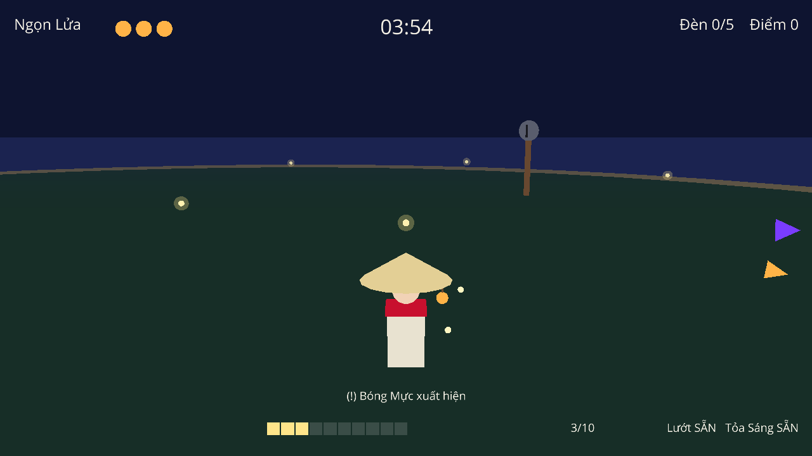
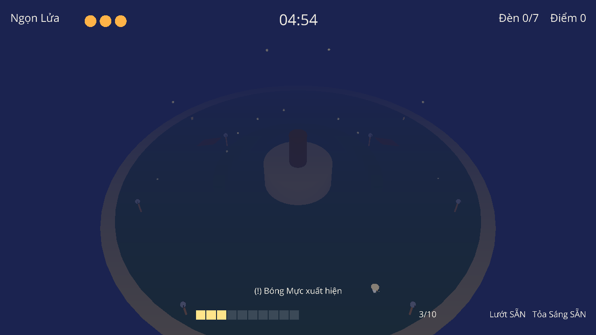
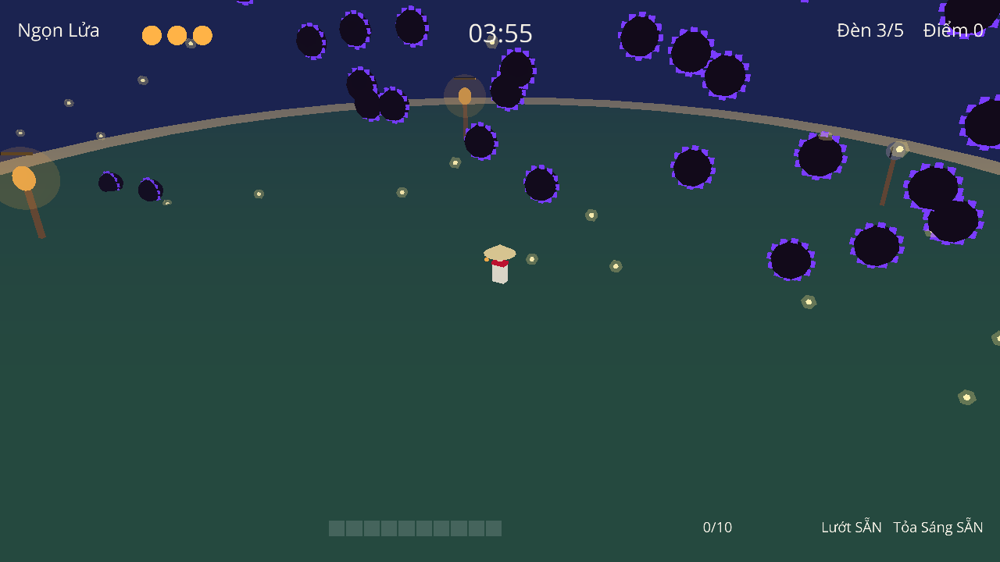
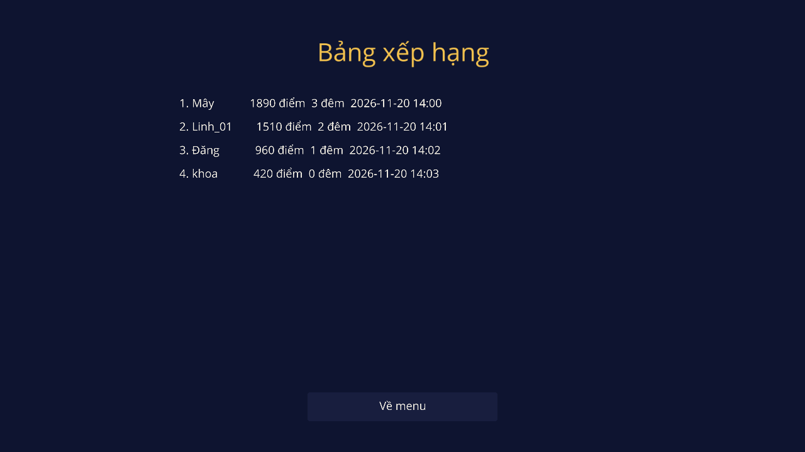

# Đảo Đèn Lồng

> **Video demo (4:31):** [demo.mp4](https://github.com/laminh-h/K5-L3A-DAY12-HoangLamMinh-2A202603566-AI-SDLC-Dao-Den-Long/releases/download/v1.0.0/demo.mp4). Gồm 1:48 tác giả **chơi trực tiếp** bằng bàn phím và chuột, bot giới thiệu Đêm 2–3, rồi test, scenario, bench, soak là output thật (dựng bằng `tools/make_demo.py`) · Bản phát hành: [v1.0.0](../../releases/tag/v1.0.0) · Đề bài lab: [docs/lab/](docs/lab/README.md)

Game 3D góc nhìn thứ ba. Bạn là Mây, người giữ đèn nhỏ tuổi đội nón lá. Bạn gom đom đóm để thắp và giữ sáng các Đèn Lồng Lớn qua 3 Đêm (Đảo Bến, Đảo Cau, Đảo Chuông) cho tới bình minh, đồng thời né Bóng Mực hút dầu và Gió Lạc cướp đom đóm.



| Đảo Chuông nhìn từ trên | Cảnh benchmark (200 Bóng Mực) | Bảng xếp hạng |
|---|---|---|
|  |  |  |

## Yêu cầu hệ thống

- macOS 11+ hoặc Linux (x86_64 / arm64). Windows cũng chạy được.
- Python **3.10–3.13** có `venv`; OpenGL 3.2+ (GPU tích hợp là đủ).
- Chế độ headless và soak chỉ cần Python, không cần GPU.

## Cài đặt và chạy (3 lệnh)

```bash
git clone https://github.com/laminh-h/K5-L3A-DAY12-HoangLamMinh-2A202603566-AI-SDLC-Dao-Den-Long.git && cd K5-L3A-DAY12-HoangLamMinh-2A202603566-AI-SDLC-Dao-Den-Long
python3 -m venv .venv && .venv/bin/python -m pip install -r requirements.txt
.venv/bin/python -m lantern.app
```

Trên Windows thay `.venv/bin/python` bằng `.venv\Scripts\python`. Dùng venv để tránh lỗi PEP 668 trên Homebrew/Ubuntu.

## Điều khiển (đổi được trong Cài đặt → Đổi phím)

| Phím mặc định | Hành động |
|---|---|
| W A S D | Di chuyển theo hướng camera |
| Chuột | Xoay camera |
| Space | Nhảy |
| Shift | Lướt (14 m/s, 0.2 s, hồi 1.5 s) |
| E | Nạp ánh sáng / châm dầu đèn gần nhất |
| Q / chuột trái | Tỏa Sáng: choáng và đẩy lùi Bóng Mực trong 5 m, tốn 3 đom đóm |
| Esc / P | Tạm dừng (Tiếp tục · Chơi lại Đêm · Cài đặt · Về menu) |

Cài đặt (được lưu): âm lượng, độ nhạy chuột, bảng màu dễ phân biệt, giảm chuyển động, chữ lớn ×1.25, đổi phím (báo phím trùng, có nút khôi phục mặc định).

## Luật và điểm (Ticket-03)

- **Mục tiêu:** lúc bình minh (240/270/300 s) phải có ≥ 60% số đèn đang sáng: 3/5, 4/6, 5/7. Hết 3 Ngọn Lửa thì thua ngay.
- Thắp đèn lần đầu tốn 10 đom đóm; đèn có dầu 100 và hao 1/s. Đèn tắt thì thắp lại tốn 5. Nhấn E ở đèn đang sáng để châm dầu (+10 mỗi đom đóm).
- Đèn có dầu ≥ 30 giữ vùng an toàn 6 m. Dưới 30, Bóng Mực vào hút dầu 5/s.
- Sức chứa = 10 + 2 × số lần thắp thành công (tối đa 20). Gió Lạc (Đêm 2, 3) cướp 3 đom đóm. Bùa Gió cho chạy nhanh trong 10 s. Rơi khỏi đảo thì mất 1 lửa.

| Sự kiện | Điểm |
|---|---|
| Mỗi đom đóm nạp vào đèn (thắp / thắp lại / châm dầu) | +5 |
| Thắp lần đầu / thắp lại | +100 / +40 |
| Bóng Mực trúng Tỏa Sáng (đang hút dầu) | +5 (+15) |
| Bình minh khi thắng: mỗi đèn sáng / mỗi Ngọn Lửa | +50 + floor(dầu) / +50 |

Tổng điểm là tổng các Đêm đã thắng, được lưu vào bảng xếp hạng (top 10) sau Bình Minh hoặc sau khi thua.

## Test, headless, bench, soak

```bash
python3 -m unittest discover -s tests -t . -v                     # 109 test (unit + CLI)
python3 tools/run_scenarios.py --phase phase-4                    # 25 scenario, mỗi cái chạy 2 lần (tất định)
python3 -m lantern.headless --seed 1 --night 1 --ticks 600 --out out.jsonl [--scenario s.json] [--inputs i.json]
.venv/bin/python -m lantern.app --bench --seed 42 --duration 30 --out bench.json
.venv/bin/python -m lantern.soak --seed 7 --nights 10 --out soak.json
.venv/bin/python -m lantern.app --export-leaderboard out.json
```

- Test Contract **v1.3**: [game.contract.json](game.contract.json). Headless chỉ dùng stdlib. Mã thoát: 0 khi chạy xong, 2 khi đầu vào sai, 1 cho lỗi khác.
- Benchmark tắt vsync (`sync-video false`). Kết quả của tác giả: [bench.json](bench.json) (Intel UHD 620: 104.7 avg / 35.4 p1-low fps, tải 1.9 s). [soak.json](soak.json): 0 crash, RAM 15.7 → 15.7 MB.
- CI (Ubuntu + macOS) chạy test, scenario và soak mỗi lần push: [.github/workflows/ci.yml](.github/workflows/ci.yml).

## Sáng tạo của tôi

- **Ông Đăng**: lời dẫn riêng cho từng Đêm ở màn giới thiệu.
- **Vệt đom đóm**: số đom đóm Mây đang mang bay vòng quanh người (chỉ là hiển thị).
- **Nhạc và hiệu ứng âm thanh tự sinh bằng code** (`tools/gen_sounds.py`): không dùng asset ngoài.
- **Lá bay** báo gió ở Đêm 3, bên cạnh phụ đề.

Tất cả chỉ nằm ở lớp hiển thị (`lantern/client.py`), không chạm vào `sim.py`. Bằng chứng: cùng 25 scenario headless vẫn cho output giống hệt từng byte ([docs/proof/phase-4](docs/proof/phase-4/README.md)).

## Tài liệu và bằng chứng

| | |
|---|---|
| Giả định / spec | [P1](docs/notes/phase-1-assumptions.md) · [P2](docs/notes/phase-2-spec.md) · [ADR P3](docs/adr/0001-lantern-fuel-and-dawn-win.md) |
| Bằng chứng | [P1](docs/proof/phase-1/README.md) · [P2](docs/proof/phase-2/README.md) · [P3](docs/proof/phase-3/README.md) · [P4](docs/proof/phase-4/README.md) |
| Thay đổi | [CHANGELOG.md](CHANGELOG.md) |
| Nhật ký AI, retro | [ai-log.md](docs/notes/ai-log.md) · [retro.md](docs/notes/retro.md) |
| Harness AI | [AGENTS.md](AGENTS.md) (`CLAUDE.md` nạp nó) · Stop hook [.claude/hooks/stop_check.py](.claude/hooks/stop_check.py) · skill [verify-phase](.claude/skills/verify-phase/SKILL.md) |
| Giấy phép, nguồn | [LICENSE](LICENSE) (MIT) · [CREDITS.md](CREDITS.md) |

## Cấu trúc

```text
lantern/sim.py          luật game tất định (12 bước/tick), không phụ thuộc đồ họa
lantern/maps.py         bản đồ chuẩn 3 Đêm
lantern/headless.py     CLI headless (Test Contract)
lantern/soak.py         soak test
lantern/bench_scene.py  cảnh benchmark + công thức FPS
lantern/storage.py      bảng xếp hạng, cài đặt, đổi phím (lưu đĩa)
lantern/client.py       client 3D Ursina (chỉ hiển thị + input)
lantern/app.py          entry point (--bench / --export-leaderboard / --screenshot)
tests/                  unit test + tests/scenarios/*
tools/                  run_scenarios.py, gen_sounds.py
```
